# Let's Go Map Builder

Editor de mapas para **Pokémon: Let's Go, Pikachu! / Eevee!**, pensado para crear mapas que se carguen como mods en
[Let's Go Recomp](../letsgo-recomp). Los modelos salen de tu propia copia del juego; el editor no incluye ningún archivo
del juego.

> [!WARNING]
> **Work in progress, en una fase muy temprana.** Los mapas ya se pueden jugar dentro de Let's Go Recomp (ver
> [Jugar el mapa en el juego](#jugar-el-mapa-en-el-juego)), con limitaciones; el formato de archivo y la interfaz pueden
> cambiar sin aviso.

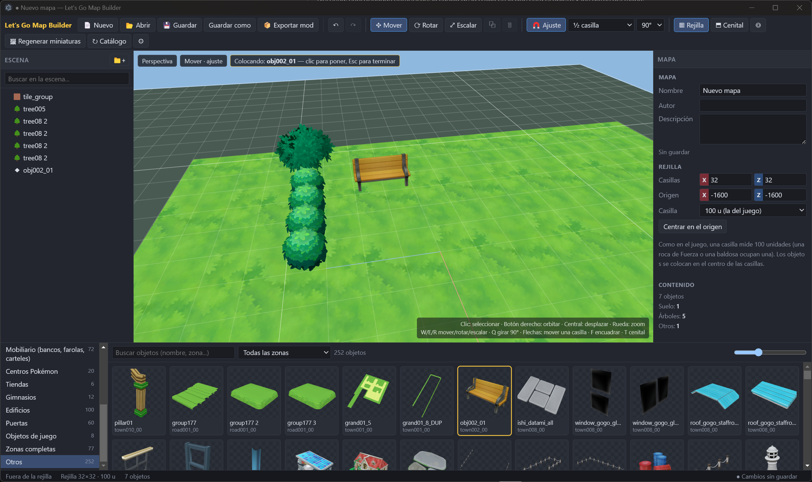

Un mapa hecho en el editor ([`examples/pueblo-prueba.lgmap`](examples/pueblo-prueba.lgmap)) y el mismo mapa dentro del
juego:

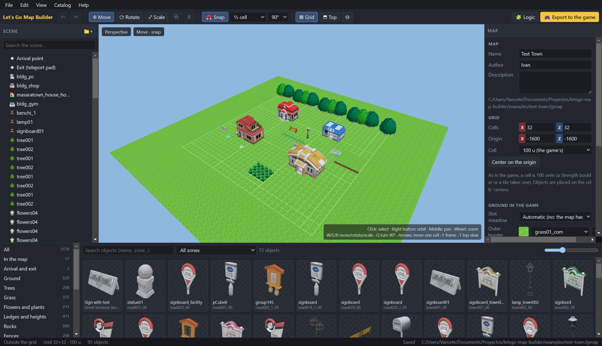
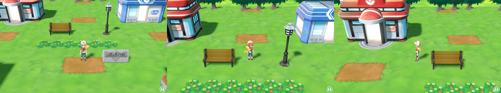

## Uso

```bash
npm install
npm run dev        # editor en modo desarrollo
npm run build      # compila a out/
npm start          # ejecuta lo compilado
```

1. Al arrancar por primera vez, elige la carpeta del juego: tu instalación de Let's Go Recomp (usa
   `extracted/romfs.bin`), una carpeta `romfs` extraída o el propio `romfs.bin`. Se detectan solas las instalaciones
   habituales.
2. Se extrae el catálogo (≈30 s) y se generan las miniaturas de los ~3000 objetos (≈1 min, en segundo plano).
   **Catálogo › Regenerar miniaturas** las vuelve a crear; **Catálogo › Reconstruir el catálogo** vuelve a extraerlo
   todo (se hace solo cuando cambia la versión del catálogo).
3. Monta el mapa:
   - **Abajo**, el catálogo por categorías (suelo, árboles, hierba, flores, saltos y desniveles, rocas, vallas,
     mobiliario, Centros Pokémon, tiendas, gimnasios, edificios, puertas, objetos de juego, zonas completas), con
     buscador y filtro por zona de origen. Arrastra una miniatura a la vista, haz doble clic para ponerla en el centro, o
     haz clic para "armarla" y coloca copias con cada clic en la vista (Esc para terminar).
   - **Izquierda**, el árbol de la escena: grupos, arrastrar para reordenar o anidar, renombrar con doble clic,
     ocultar y bloquear.
   - **Centro**, la vista 3D con gizmo de mover / rotar / escalar (W / E / R) y ajuste a la rejilla.
   - **Derecha**, el inspector: posición, rotación y escala numéricas (admite operaciones: `350+100`), la casilla de la
     rejilla en la que está el objeto y las propiedades del mapa.
4. Para Pokémon salvajes, coloca una **Zona de hierba alta** (categoría *Hierba*, la primera) y elige en el inspector su
   tamaño en casillas, los niveles y qué Pokémon aparecen y con qué probabilidad (ver
   [Zonas de hierba y Pokémon salvajes](#zonas-de-hierba-y-pokémon-salvajes)).
5. Para el suelo, las **baldosas** de la categoría *Suelo* se exportan al juego; **Editar › Rellenar el suelo** (o
   *Rellenar* en el inspector del mapa) cubre la rejilla con baldosas de 4 × 4. Para desniveles, saltos y escaleras usa
   **Elevación** y **Escaleras** (categoría *Saltos y desniveles*), y para un cartel que se lee con A, **Cartel con texto**
   (categoría *Mobiliario*). Ver [Desniveles, saltos y escaleras](#desniveles-saltos-y-escaleras) y [Carteles](#carteles).
6. Coloca los marcadores de la categoría **Llegada y salida**: el *Punto de llegada* (la flecha: dónde aparece el
   jugador) y la *Salida* (la baldosa de teletransporte que devuelve a Pueblo Paleta). Son opcionales; no pongas la
   llegada pegada a la salida.
7. **Archivo › Guardar** crea un `.lgmap`; **🎮 Exportar al juego** (o Ctrl+E) crea el mod (ver abajo).

La barra de menús (**Archivo, Editar, Ver, Catálogo, Ayuda**) tiene todas las órdenes con su atajo; la barra de
herramientas solo las de uso continuo (deshacer, mover/rotar/escalar, ajuste a la rejilla, vista y exportar).

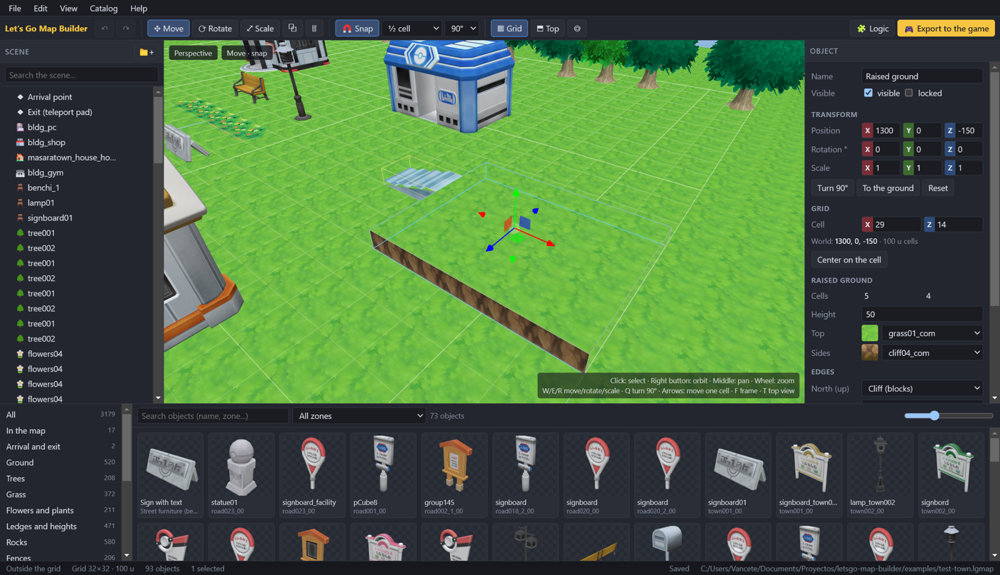

### Controles

| | |
|---|---|
| Clic | seleccionar (Ctrl/Mayús: añadir a la selección) |
| Botón derecho / central / rueda | orbitar / desplazar / zoom |
| W / E / R | mover / rotar / escalar |
| Q | girar 90° |
| Flechas, RePág/AvPág | mover una casilla (Mayús: ¼), subir/bajar |
| X | activar/desactivar el ajuste a la rejilla |
| G / T / F | rejilla / vista cenital / encuadrar |
| Ctrl+D, Ctrl+G, Supr | duplicar, agrupar, eliminar |
| Ctrl+Z / Ctrl+Y | deshacer / rehacer |
| Ctrl+N / O / S / Mayús+S | nuevo / abrir / guardar / guardar como |
| Ctrl+E | exportar al juego |
| Ctrl+L | lógica (editor de bloques) |

## La rejilla

Como en el juego, **una casilla mide 100 unidades** (la roca de Fuerza y la baldosa de teletransporte miden 100×100) y
los objetos que coloca el propio juego están en los centros de casilla (múltiplos de 50). El ajuste por defecto es de ½
casilla; "Centro de casilla" coloca cada objeto en el centro. Tamaño y origen de la rejilla se cambian en el inspector
del mapa.

## De dónde salen los objetos

- `bin/archive/field/buildmodel.gfpak`: los objetos que el juego coloca por separado (hierba alta, flores, árboles
  cortables, rocas de Fuerza, farolas, puertas de Centros y tiendas, máquina del PC...). Los nombres se recuperan de las
  rutas que cita `placement.gfpak` (en el archivo solo hay hashes FNV-1a de 64 bits).
- Los modelos de cada zona (`bin/archive/field/<area>/<zona>.gfpak`) están "horneados": cada grupo (`tree001`,
  `bldg_pc`, `town010_00_build01`) junta todas sus instancias en coordenadas de mundo. El editor separa cada grupo en
  componentes conexos, agrupa los que se tocan en instancias, elimina duplicados y deja cada pieza con su origen en el
  centro de su base. Así aparecen Centros Pokémon, tiendas, casas, bancos, farolas, carteles, vallas, desniveles...
- Cada zona completa, para construir encima de un mapa existente.
- Baldosas de suelo (1×1 y 4×4 casillas) con cada textura de terreno que usan las zonas.

Formatos leídos: GFLXPACK (LZ4), GFBMDL (FlatBuffers), BNTX (deswizzle Tegra + BC1/BC2/BC3/BC4/BC5/BC7) y RomFS. Todo en
TypeScript, en `src/shared/formats/`.

## Formato del mapa (`.lgmap`)

JSON, unidades del juego (Y hacia arriba, 1 casilla = 100), rotaciones en grados (orden XYZ):

```jsonc
{
  "format": "letsgo-map", "version": 1,
  "name": "Mi pueblo", "author": "", "description": "",
  "grid": { "cellSize": 100, "width": 32, "depth": 32, "originX": -1600, "originZ": -1600 },
  "objects": [
    { "id": "o…", "name": "bldg_pc", "asset": "zp.area03.town003_00.bldg_pc.0", "parent": null,
      "position": [-600, 0, -500], "rotation": [0, 0, 0], "scale": [1, 1, 1], "visible": true, "locked": false }
  ],
  // de dónde sale cada modelo usado, para reconstruirlo desde los archivos del juego sin el editor
  "assets": {
    "zp.area03.town003_00.bldg_pc.0": { "name": "bldg_pc", "category": "pc",
      "source": { "kind": "zonePiece", "pak": "bin/archive/field/area03/town003_00.gfpak", "fileIndex": 0,
                  "family": "bldg_pc", "pivot": [x, y, z], "instance": 0 } }
  }
}
```

Además, el mapa puede llevar `slotGround` (la pradera del hueco bajo el mapa: `true`/`false`; sin poner, solo si el mapa
no tiene baldosas) y `border` (`{ "texture", "cells" }`: suelo alrededor del mapa), y los objetos del editor sus
ajustes: `grass` (zona de hierba), `terrain` (`w`, `d`, `height`, `top`, `side`, `edges: { n, e, s, w: "wall" | "ledge" }`),
`stairs` (`w`, `length`, `height`, `texture`) y `sign` (`{ "text" }`).

`source.kind`: `model` (un modelo entero de un `.gfpak`, con su ruta RomFS si se conoce), `zonePiece` (una instancia de
un grupo de un modelo de zona, con el punto de su base en coordenadas de la zona), `zone` (zona completa) o `tile`
(baldosa generada con una textura del juego) o `marker` (llegada y salida). Los objetos con `asset: null` son grupos; la posición de un hijo es
relativa a su padre.

## Jugar el mapa en el juego

1. En el editor, **🎮 Exportar al juego**: elige la carpeta `mods/` de tu instalación de Let's Go Recomp (se propone sola)
   y uno de los cuatro huecos de mapa. Se crea `mods/<Nombre del mapa>/`.
2. En el lanzador de Let's Go Recomp, pestaña **Mods**, activa el mod (y desactiva otros mods de mapas o que cambien
   `placement.gfpak` / `script_amx.gfpak`).
3. Juega y ve a **Pueblo Paleta**: en el camino entre las casas del norte hay un teletransportador nuevo (la baldosa del
   gimnasio de Ciudad Azafrán). Písalo para entrar en tu mapa, con el efecto de teletransporte del juego; la baldosa de
   salida del mapa te devuelve a Paleta igual.

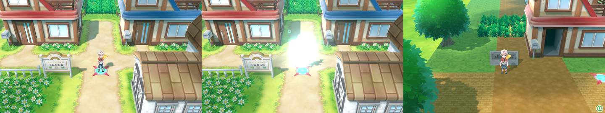

Un mapa exportado ahora (suelo de baldosas, hierba alta, árboles con sombra, un cartel):

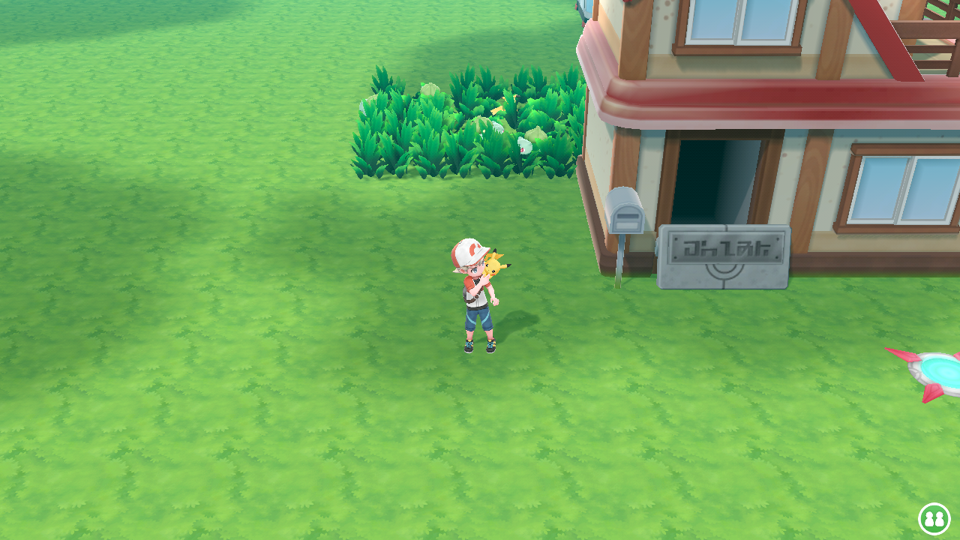

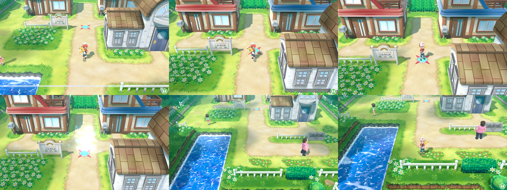

## Desniveles, saltos y escaleras

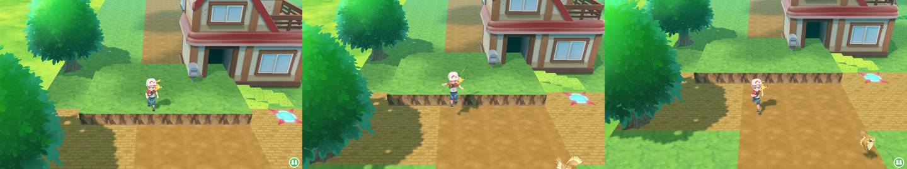

- **Elevación**: un rectángulo de casillas elevado `Altura` unidades sobre la altura del objeto (en el juego los saltos
  miden 50), con una textura arriba y otra en los lados. Cada borde (norte, este, sur, oeste) es un **acantilado**, que no
  se pasa, o un **salto**, por el que el jugador baja saltando pero no sube. Varias elevaciones pueden tocarse; manda la
  más alta en cada casilla.
- **Escaleras**: `Ancho` × `Largo` casillas que suben `Altura` hacia donde mira el objeto (0°: norte; gíralo con Q).
  Ponlas con el extremo alto contra el borde de una elevación de su misma altura.
- Lo que pongas encima (el punto de llegada, la salida, zonas de hierba) se coloca a la altura del terreno.

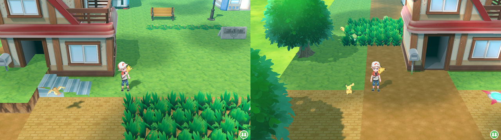

Cómo lo hace el juego y cómo se exporta (`src/shared/terrain.ts`; el editor dibuja exactamente lo mismo que se exporta):

- El **suelo** (`<hueco>_floor.gfbcol`) es una sola malla a todas las alturas: en la Ruta 1 las terrazas están a 0, 50,
  100... con caras verticales donde cambia la altura. El editor calcula una altura por casilla y escribe los rectángulos
  de cada altura, las rampas de las escaleras y esas caras verticales.
- Los **acantilados** son paredes (`col_wall`) en el borde de la parte alta.
- Un **salto** no es una pared normal: es una caja cerrada y fina de paredes **`col_jump`**, una cara en la línea del
  borde y otra 25 unidades hacia la parte baja (Ruta 1: z = −815 y −790). El juego deja atravesarla solo hacia abajo y
  con la animación del salto.
- En los archivos de pared, el campo 0 de cada polígono es el índice de su nombre en la lista de nombres del archivo
  (`col_wall`, `col_sky`, `col_water`, `col_safety`, `col_jump`...); en los de suelo igual (`col_grass`, `col_ground`,
  `col_sea`: el tipo de suelo).

## Carteles

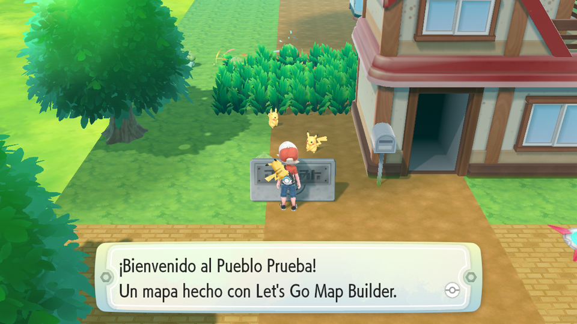

El **Cartel con texto** usa el cartel de Pueblo Paleta; su texto se escribe en el inspector. En el juego, al pulsar A
delante (por su cara delantera) aparece la ventana con el texto: dos líneas por ventana, las siguientes van apareciendo,
y una línea en blanco empieza una ventana nueva. Hasta 8 carteles por mapa.

Cómo funciona (`src/shared/signs.ts`):

- La **lista 17** del placement de una zona son las cosas que se inspeccionan con A: posición, una caja que hay que
  encarar (80 × 100 × 50 en Paleta, girada hacia el lado desde el que se lee) y, en el campo 11 de la transformada, el
  **hash de un evento de script**. El jugador tiene que poder entrar en esa caja: la pared del cartel es más fina que el
  modelo (con la caja del modelo, de 69 de fondo, no se llegaba).
- `bin/script/param/script_id/script_id_record.bin` registra **cada evento** con el script que lo atiende y sus mensajes
  (`0x59892b61…` → `bin/script/amx/town001.amx`, `script/town001.dat`). Al entrar en un mapa el juego carga los mensajes
  de los eventos de sus zonas; al inspeccionar, ejecuta el script con el hash del evento en su variable global 0.
- Los scripts son **AMX (Pawn) de 64 bits en codificación compacta** (cada celda en grupos de 7 bits, el más
  significativo primero, el bit alto en todos los bytes menos el último y el bit 6 del primero como signo), con opcodes
  "empaquetados" (operando en los 32 bits altos) y nombres de nativas por hash (`h = h·0x83 ^ byte`, nombres en claro en
  `.rodata` del ejecutable: `MsgWin_`, `GetTargetFieldObjectID`, `ABKeyWait_`...). La función principal de
  `town001.amx` hace un `switch` sobre el evento; cada caso llama a una función que pasa la etiqueta del mensaje
  (FNV-1a 64 de `msg_town001_kanban_01`) a otra común que gira al jugador hacia el cartel y abre la ventana.
- El mod usa ese script con dos parches del mismo tamaño (no se mueve nada, así que todos los saltos relativos siguen
  valiendo): la tabla del `switch` lleva los eventos de los carteles a una función, y esa función muestra el mensaje cuya
  etiqueta es **el propio hash del evento** (`LOAD_P_PRI 0` en vez de una constante).
- Los mensajes van en `bin/message/<idioma>/script/<hueco>.dat` y `.tbl` (los de los huecos de prueba existen y están
  registrados en `bin/message/asset.tbl`), en los 10 idiomas. Formato: una sección; por línea, desplazamiento, longitud
  y flags; el texto en UTF-16 cifrado por línea (clave 0x7C89 + 0x2983·línea, XOR por carácter y la clave rotada 3 bits a
  la izquierda). Salto de línea `0x000A`; `0x0010 0x0001 0xBE00` antes del salto desplaza una línea y `0xBE01` empieza
  ventana nueva. El `.tbl` (AHTB) lista las etiquetas y termina en `msg_<zona>_max`.

## Lógica con bloques

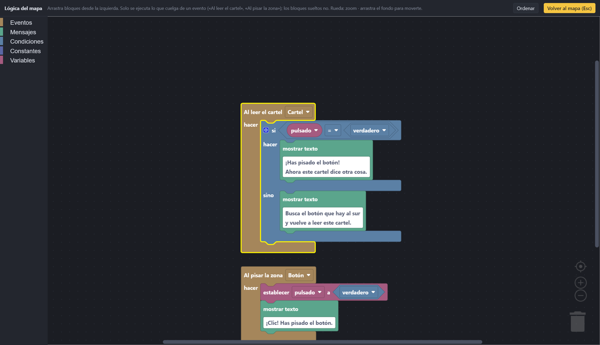

**🧩 Lógica** (Ctrl+L, o *Añadir lógica* en el inspector de un cartel o de una zona) abre el editor de bloques del mapa
([Blockly](https://developers.google.com/blockly)): se arrastran bloques desde la izquierda, se encajan o se dejan
sueltos, la rueda hace zoom y arrastrando el fondo se mueve uno por el lienzo. Solo se ejecuta lo que cuelga de un
**evento**:

- **Al leer el cartel** *X*: cuando el jugador lee ese cartel con A (sustituye al texto del inspector).
- **Al pisar la zona** *X*: cuando entra en esa **Zona de activación** (categoría *Objetos de juego*: un rectángulo de
  casillas que en el juego no se ve; encima se puede poner cualquier objeto para que parezca un botón). Una vez por visita
  al mapa; hasta 6 zonas.

Dentro: **mostrar texto**, **variables** (crear, establecer, cambiar en), **constantes** (número, verdadero/falso),
**condiciones** (si / si no si / si no; =, ≠, <, ≤, >, ≥; y, o, no; + − ×). Las variables son números (verdadero = 1,
falso = 0) y **se guardan en la partida**; hasta 15 por mapa. Los avisos (un bloque sin valor, un evento sin objeto...)
salen abajo a la derecha y al exportar.

El ejemplo [`examples/cartel-y-boton.lgmap`](examples/cartel-y-boton.lgmap) es el de la imagen; en el juego:

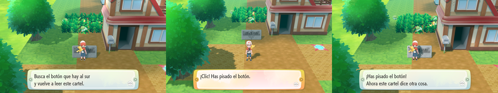

Cómo se lleva al juego (`src/shared/logic.ts`, `src/shared/amxgen.ts`):

- La lógica se guarda en el mapa (`logic`) como el JSON de Blockly; la exportación lo lee sin Blockly y lo convierte en
  un pequeño programa (eventos, sentencias, expresiones).
- **El script** de la zona se genera: el de Pueblo Paleta (`town001.amx`, por sus funciones de mensaje) con nuestro
  código **añadido al final de su código** (en Pawn las llamadas y los saltos son relativos y los datos se direccionan
  desde su propia sección, así que nada se mueve), una función principal nueva (el punto de entrada `cip`) que compara el
  hash del evento (global 0) con los nuestros, y una nativa más en su tabla (`WorkSet`; hay que mover detrás las demás
  tablas y las secciones, incluido el campo `overlays` de la cabecera de Pawn 3.3: sin moverlo el juego se colgaba).
  Las expresiones dejan su valor en PRI; los operadores binarios llevan la izquierda en ALT.
- **Mostrar texto** en un cartel llama a la función de los carteles de Paleta (`0x1d80`: gira al jugador, abre la
  ventana, espera y la cierra); en una zona, a la de mensaje sin girar (`0xf40`) y luego a esperar (`0xe80`) y cerrar
  (`0xdb8`). Cada texto es una línea del archivo de mensajes de la zona.
- **Las variables** son *works* del juego (`WorkGet(hash)`, `WorkSet(hash, valor)`), que se guardan en la partida: los
  nombres de los works están en `bin/flagwork/*.tbl` (AHTB: el hash del nombre da su casilla en la partida, por orden) y
  `system_works.tbl` tiene 15 casillas llamadas `NOUSED`; el mod las renombra (`LGMAP_WORK_01`...).
- **Las zonas** son entradas de la **lista 14** del placement (las que el juego usa para escenas al pasar por un sitio):
  posición, un área (su tamaño es **medio lado**, desde el centro), el hash del evento, y un work con un valor: el juego
  solo la dispara mientras ese work vale eso. Si la condición sigue cumpliéndose, se dispara una y otra vez mientras el
  jugador sigue dentro; por eso cada zona tiene su work (en `zone_works.tbl`, que tiene 6 casillas libres) y su script lo
  pone a 1 antes de nada.
- Los eventos de carteles y zonas se registran en `script_id_record.bin` con el script y los mensajes de la zona.

## Zonas de hierba y Pokémon salvajes

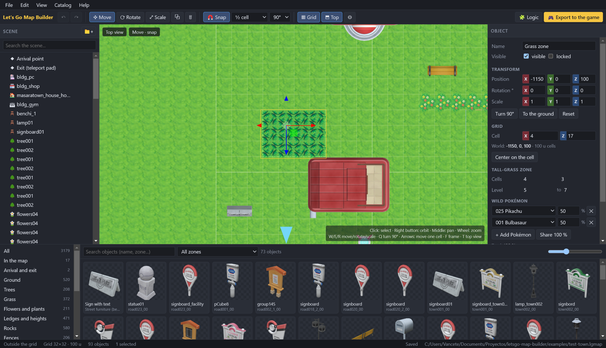

Cada **Zona de hierba alta** del mapa es un rectángulo de casillas con su propia tabla: hasta 10 Pokémon (los 151 de
Kanto, Meltan y Melmetal), la probabilidad de cada uno (deben sumar 100 %; **Repartir 100 %** lo iguala) y el rango de
niveles. La misma tabla vale para Pikachu y Eevee.

En el juego la zona se llena de hierba alta animada y los Pokémon aparecen y deambulan por ella, como en las rutas; al
tocar uno empieza la captura:

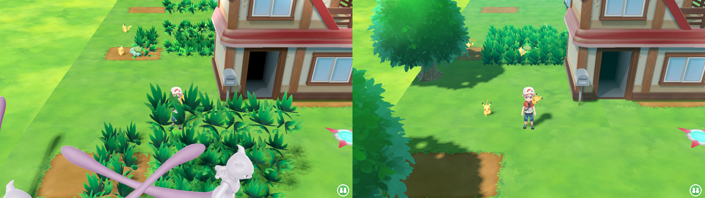
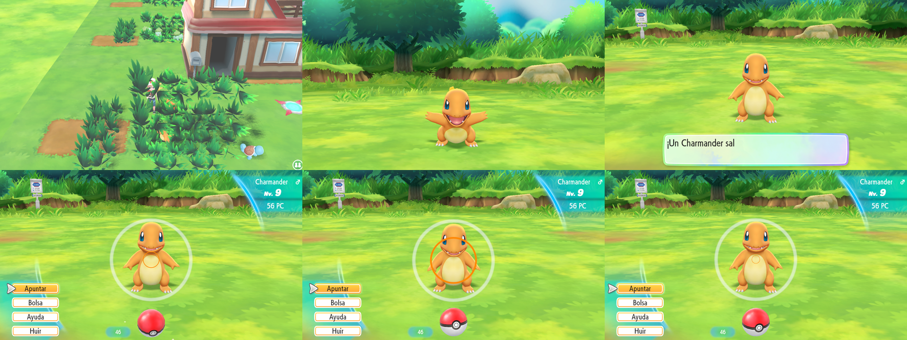

Cómo se construye (`src/shared/encounters.ts`):

- **Una zona del juego por zona de hierba.** El juego tiene una tabla de salvajes por *zona* (un mapa se divide en
  zonas; cada una con su forma, su lista de objetos, sus scripts y su tabla), así que cada zona de hierba se exporta como
  una zona nueva del hueco (`<hueco>_g1`, `_g2`…): su forma es el rectángulo de hierba y la zona base del mapa cubre el
  resto de casillas, sin solaparse. Se registra en `ZoneNameHashTable.tbl` y lleva sus scripts (`.amx`).
- **La hierba** es un *parche de vegetación* (lista 5 del placement de la zona): una posición, una forma `.gfbcol` de
  casillas alrededor de ella y el modelo de mata (`enc_grass01.gfbmdl`), con la que el juego rellena la forma. Así son
  todas las hierbas altas de las rutas del juego. Las 75 formas `_enc*.gfbcol` del juego llevan, además de la posición,
  un **color por vértice** (atributo `{tipo 7, formato 3, 4}`: cuatro bytes, blanco en casi todas) que el juego lee para
  cada mata; sin él leía basura y las matas salían de tamaños y tonos al azar (la captura de la izquierda).
- **La tabla** se añade a `bin/field/param/encount/encount_data_p.bin` (Pikachu) y `_e.bin` (Eevee), copiando la de la
  Ruta 1 (cuántos aparecen a la vez, cada cuánto) y cambiando huecos y niveles. Formato de una tabla (FlatBuffers):
  campo 0 = hash de la zona; hierba: 4 máximo a la vez, 5 intervalo, 7/8 nivel mínimo/máximo, 10 los 10 huecos
  `{0 probabilidad %, 1 especie}`; agua 12–18 y cielo 35–41 con la misma forma (vaciados).

### Cómo funciona

El juego no tiene un formato de mapa abierto: el mod **sustituye uno de sus mapas sin usar** por el tuyo, con los mismos
tipos de archivo que usan sus mapas. Los huecos son las cuatro salas de pruebas de personajes (`test_chr01`…`04`): el
juego las tiene registradas (con su modelo, colisiones, terreno y placement) pero ningún camino lleva a ellas.

| Archivo del mod (`romfs/…`) | Qué es |
|---|---|
| `bin/field/model/<hueco>/<hueco>.gfbmdl` | el modelo del mapa: los triángulos de cada objeto, tomados de los datos de vértice originales del juego (no de la caché del editor) y movidos a su sitio; todo en un modelo, con los materiales originales |
| `bin/archive/field/<hueco>.gfpak` | los recursos del hueco más los shaders (`<material>.bnsh_vsh/.bnsh_fsh`) y texturas (`<textura>.bntx`) de cada material, copiados de las paks de donde vienen las piezas |
| `bin/field/model/<hueco>/<hueco>_floor/_wall/_zone.gfbcol` | colisiones: el suelo a todas las alturas, paredes alrededor de la rejilla, cajas alrededor de los objetos sólidos (edificios, árboles, rocas, vallas, mobiliario), acantilados y saltos, y la forma de la zona |
| `bin/field/param/terrain/<hueco>/terrain_data.bin` | el bloque de terreno del hueco, con el tamaño del mapa (y altura) |
| `bin/archive/field/placement.gfpak` | el placement del hueco (ajustes de un mapa exterior, sin los personajes de prueba, con la baldosa de vuelta y los carteles); el de `area02` con el teletransportador en Pueblo Paleta |
| `bin/archive/script_amx.gfpak` | los scripts que toda zona necesita (`<zona>.amx`, `init_<zona>.amx`); las salas de prueba no los tienen y sin ellos el juego se cuelga al entrar. Con carteles, el de la zona es el que los atiende |
| `bin/script/param/script_id/script_id_record.bin` | (con carteles o lógica) sus eventos, con su script y sus mensajes |
| `bin/message/<idioma>/script/<hueco>.dat/.tbl` | (con carteles o lógica) sus textos |
| `bin/flagwork/system_works.tbl`, `zone_works.tbl` | (con variables o zonas de activación) los nombres de sus works |
| `bin/field/model/<hueco>/<hueco>_gN_zone/_enc.gfbcol` | forma de cada zona de hierba y de su parche de hierba |
| `bin/field/param/encount/encount_data_p/_e.bin` | las tablas de Pokémon salvajes de las zonas de hierba |
| `bin/field/param/placement/table/ZoneNameHashTable.tbl` | los nombres de las zonas nuevas |
| `bin/lgmap/<nombre>.lgmap` | el mapa del editor (el juego no lo lee; sirve para volver a abrirlo) |

**El suelo.** Las baldosas del editor se exportan dibujadas con un material de suelo del juego (`FieldObjectShader`, el
de los adoquines de la Ruta 1, `roadstone01_com` en `area02/road001_00`) cuya textura se cambia por la de la baldosa.
El hueco trae su propio suelo, una pradera de pruebas de 40 × 40 casillas con las UV en islas (se le notan franjas): por
defecto solo se pone bajo mapas sin baldosas (*Pradera del hueco* en el inspector del mapa). Más allá del borde del mapa
el juego no dibuja nada, solo su fondo: **no es un suelo de la sala de pruebas** (el único modelo que carga el mapa es el
nuestro, comprobado con el registro de archivos abiertos, y subir el mapa entero 300 unidades no cambia ese fondo), así
que bajar o subir el mapa no lo tapa; para eso está el **Borde exterior** (un anillo de suelo alrededor, solo visual).

Sin la interfaz: `node scripts/build-map-mod.ts <mapa.lgmap> <caché del catálogo> <carpeta del juego> <carpeta mods> [nombre]`.

### Lo que hubo que averiguar

Notas de cómo se llegó a esto, por si alguien sigue el trabajo:

- **Placement** (`bin/archive/field/placement.gfpak`, un FlatBuffer por mapa en `bin/field/param/placement/<mapa>.bin`;
  los nombres se recuperan probando rutas contra los hashes FNV-1a 64): la raíz es el mapa (campo 1 = hash del nombre),
  con un vector de zonas; cada zona tiene su información (campo 1 = hash del nombre de zona, p. ej. `town001` = Pueblo
  Paleta) y unas 28 listas de objetos. Lista 2: objetos con modelo (`warp01.gfbmdl`…). Lista 4: **warps** (posición del
  disparador, mapa destino *por nombre*, hash de la zona destino, posición y rotación de llegada, caja del disparador,
  y en las puertas el modelo y la animación de la puerta). Lista 25: baldosas de teletransporte del gimnasio de Azafrán
  (solo dentro del mismo mapa). Un warp se activa al entrar en su caja **caminando en la dirección de la caja**, así
  que el teletransportador lleva cuatro, una por dirección.
- **Editar FlatBuffers sin esquema**: los offsets solo apuntan hacia delante, así que lo que cambia se escribe de nuevo al
  final del archivo y se re-enlaza (`src/shared/formats/fbedit.ts`). Para copiar tablas sin saber qué campos son
  offsets, el editor **aprende el esquema** de cientos de instancias (un campo es offset si en todas apunta a un string,
  una tabla o un vector de ellas).
- **Mapas de prueba**: `test_chr01` se colgaba al entrar; enganchando `nn::fs::OpenFile` (`LARECOMP_HOOK_DUMP` del
  runtime) se vio que pedía `bin/script/amx/test_chr01.amx` y luego `init_test_chr01.amx`, que no existen. El script
  vacío que comparten muchas zonas sirve para los dos.
- **`terrain_data.bin`** lista los bloques de terreno de cada mapa: caja, modelo, animación, colisión de pared y de suelo.
- **Esquemas aprendidos de muchas muestras**: copiar las zonas aprendiendo solo de las del hueco (1–3 zonas) clasificaba
  mal campos y corrompía la primera zona de hierba al añadir la segunda; ahora el esquema de zona se aprende de todas las
  zonas de todos los mapas. Los strings vacíos (longitud 0) cuentan como strings.
- **Sombras pixeladas**: los campos 13..18 de la raíz del placement no son los límites del mapa sino el volumen de la
  sombra alrededor de la cámara (area02: −1536, −1024, −1536 .. 1536, 1024, 512; interiores −1024..768). El exportador
  los llenaba con el tamaño del mapa y estiraba el mapa de sombras sobre todo él. Ahora la raíz del hueco se reescribe con
  la forma y los valores de la de `area02` (campo 6 = exterior, 7..12 iluminación y niebla de exterior, 13..18, 23/24),
  conservando su nombre y sus hijos.
- **Sombras falsas**: los árboles y otras piezas proyectan su sombra con mallas invisibles (`FieldShadowOnlyShader`) que
  el catálogo quita de las piezas; al exportar se recuperan las de la misma familia que caen dentro de la caja de la pieza.
- **Campos a 0**: las tablas de FlatBuffers omiten los campos con su valor por defecto, así que muchas transformadas del
  juego no tienen Y (o X, o Z). Al copiar una plantilla hay que **añadir** el campo (`cloneTable` con campos extra), no
  solo escribirlo: la plantilla de parche de hierba no tenía Y y, con el mapa subido, la hierba se quedaba a altura 0.
- **Teletransportadores**: los de la lista 25 pueden llevar a otro mapa (los de `t009r02` y `r010r01` lo hacen); los del
  gimnasio de Azafrán tienen el campo 10 = 1, que los deja dentro del mismo mapa. Usando como plantilla uno sin ese campo
  se cambia de mapa con el efecto de teletransporte; antes se usaban warps de la lista 4 (sin efecto).
- **Llegada pegada a la salida**: con el punto de llegada al lado de la baldosa de salida, el teletransportador de
  Paleta no llevaba al mapa.
- **Materiales**: los campos 8 y 10 de un material son su número dentro del modelo (su shader en la lista de shaders);
  al fusionar materiales de varios modelos hay que reescribirlos o el juego lee fuera de la lista.
- Las pruebas se hicieron con las partidas guionizadas de Let's Go Recomp (`tools/scenario_shot.sh`, `mod = <nombre>` en
  el ini), que llevan una copia de la partida a Pueblo Paleta y hacen capturas.

### Limitaciones

- Solo se llega desde Pueblo Paleta (posición fija del teletransportador) y solo un mod de mapa activo a la vez: el mod
  reemplaza `placement.gfpak` y `script_amx.gfpak` enteros (y, con carteles, `script_id_record.bin`).
- Las elevaciones y escaleras van alineadas a la rejilla; las escaleras suben en línea recta. Las texturas de los lados y
  las escaleras usan un material de objeto, sin la mezcla de hierba en el borde de los acantilados del juego.
- Los carteles y las zonas de activación responden en la zona base del mapa (no se ha probado dentro de una zona de
  hierba). Zonas de activación: hasta 6, y una vez por visita. Variables: hasta 15, solo números.
- La lógica es sencilla de momento: eventos de leer y pisar, textos, variables y condiciones (sin bucles, sin preguntas
  sí/no, sin dar objetos ni mover personajes).
- Las zonas completas y los objetos animados (puertas) se exportan como geometría fija. Las matas de hierba alta sueltas
  del catálogo también: para encuentros hay que usar una *Zona de hierba alta*.
- Las zonas de hierba son rectángulos alineados a la rejilla (no giran) y su tabla es la misma en Pikachu y Eevee; no
  hay Pokémon en el agua ni voladores.
- Las puertas de los edificios no llevan a ningún sitio.

## Pendiente

- Elegir en el editor el mapa y el sitio del teletransportador de entrada.
- Bordes de acantilado con la hierba del juego (su `FieldCliffShader01`), rampas y escaleras en curva.
- Carteles con otros modelos y NPCs que hablan (la misma vía: lista de personajes + evento + script).
- Más bloques: preguntas sí/no, dar objetos, combates, mover y girar personajes, sonidos, esperar; zonas que se
  rearman al salir de ellas.
- Pokémon en el agua y voladores (las mismas tablas tienen esos bloques), tablas distintas para Pikachu y Eevee.
- NPCs y objetos del juego (otras listas de placement).
- Los materiales del visor se aproximan con iluminación Lambert; los shaders de terreno que mezclan varias texturas
  usan solo la principal.

## Estructura

```
src/shared/formats/   lectores de formatos del juego (gfpak, lz4, flatbuf, gfbmdl, bntx, bcn, gamefs, png)
src/shared/extract.ts construcción del catálogo (modelos LGM + texturas PNG en la caché)
src/shared/lgm.ts     formato de modelo de la caché
src/shared/placement.ts  placement del juego: warps, teletransportadores, listas de objetos
src/shared/mapbuild.ts   exportación al juego (modelo fusionado, pak, colisiones, terreno, placement, scripts)
src/shared/terrain.ts    alturas por casilla: suelo, acantilados, saltos, escaleras y sus superficies
src/shared/collision.ts  archivos .gfbcol (nombres por polígono, color por vértice)
src/shared/signs.ts      carteles: AMX compacto, mensajes cifrados, registro de eventos, works renombrados
src/shared/logic.ts      la lógica de bloques: lee el JSON de Blockly
src/shared/amxgen.ts     genera el script de la zona (AMX) desde los carteles y la lógica
src/renderer/src/logic/  los bloques del editor (Blockly)
src/shared/encounters.ts zonas de hierba: zonas nuevas, parches de vegetación, tablas de salvajes, nombres de zona
src/shared/pokemon.ts    especies de Let's Go
src/main/             proceso principal de Electron (ajustes, catálogo en un worker, archivos, mods)
src/renderer/         interfaz (React + three.js): store con deshacer, vista 3D, miniaturas, paneles
scripts/              utilidades de desarrollo: extract-cli, build-map-mod (exportar un .lgmap sin la interfaz),
                      pakinfo, pakhash, pakextract, fbdump, coldump, listdump, mdlinfo, meshattrs, rootfields, schema,
                      warps, debugtable, texdump, cdp (pruebas automáticas)
```

La caché vive en `%APPDATA%/letsgo-map-builder/library`.
