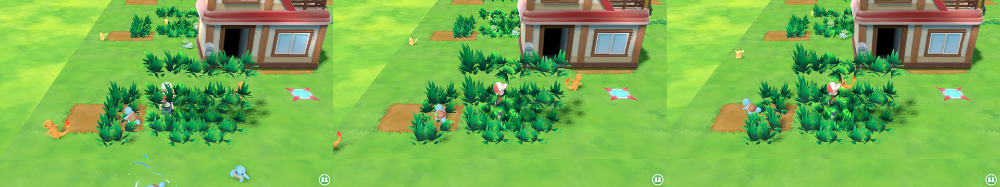

# Let's Go Map Builder

Editor de mapas para **Pokémon: Let's Go, Pikachu! / Eevee!**, pensado para crear mapas que se carguen como mods en
[Let's Go Recomp](../letsgo-recomp). Los modelos salen de tu propia copia del juego; el editor no incluye ningún archivo
del juego.

> [!WARNING]
> **Work in progress, en una fase muy temprana.** Los mapas ya se pueden jugar dentro de Let's Go Recomp (ver
> [Jugar el mapa en el juego](#jugar-el-mapa-en-el-juego)), con limitaciones; el formato de archivo y la interfaz pueden
> cambiar sin aviso.


Un mapa hecho en el editor ([`examples/pueblo-prueba.lgmap`](examples/pueblo-prueba.lgmap)) y el mismo mapa dentro del
juego:


## Uso

```bash
npm install
npm run dev        # editor en modo desarrollo
npm run build      # compila a out/
npm start          # ejecuta lo compilado
```

1. Al arrancar por primera vez, elige la carpeta del juego: tu instalación de Let's Go Recomp (usa
   `extracted/romfs.bin`), una carpeta `romfs` extraída o el propio `romfs.bin`. Se detectan solas las instalaciones
   habituales.
2. Se extrae el catálogo (≈30 s) y se generan las miniaturas de los ~3000 objetos (≈1 min, en segundo plano).
   **🖼 Regenerar miniaturas** las vuelve a crear; **↻ Catálogo** vuelve a extraerlo todo.
3. Monta el mapa:
   - **Abajo**, el catálogo por categorías (suelo, árboles, hierba, flores, saltos y desniveles, rocas, vallas,
     mobiliario, Centros Pokémon, tiendas, gimnasios, edificios, puertas, objetos de juego, zonas completas), con
     buscador y filtro por zona de origen. Arrastra una miniatura a la vista, haz doble clic para ponerla en el centro, o
     haz clic para "armarla" y coloca copias con cada clic en la vista (Esc para terminar).
   - **Izquierda**, el árbol de la escena: grupos, arrastrar para reordenar o anidar, renombrar con doble clic,
     ocultar y bloquear.
   - **Centro**, la vista 3D con gizmo de mover / rotar / escalar (W / E / R) y ajuste a la rejilla.
   - **Derecha**, el inspector: posición, rotación y escala numéricas (admite operaciones: `350+100`), la casilla de la
     rejilla en la que está el objeto y las propiedades del mapa.
4. Para Pokémon salvajes, coloca una **Zona de hierba alta** (categoría *Hierba*, la primera) y elige en el inspector su
   tamaño en casillas, los niveles y qué Pokémon aparecen y con qué probabilidad (ver
   [Zonas de hierba y Pokémon salvajes](#zonas-de-hierba-y-pokémon-salvajes)).
5. Coloca los marcadores de la categoría **Llegada y salida**: el *Punto de llegada* (la flecha: dónde aparece el
   jugador) y la *Salida* (la baldosa de teletransporte que devuelve a Pueblo Paleta). Son opcionales.
6. **Guardar** crea un `.lgmap`; **🎮 Exportar al juego** crea el mod (ver abajo).

### Controles

| | |
|---|---|
| Clic | seleccionar (Ctrl/Mayús: añadir a la selección) |
| Botón derecho / central / rueda | orbitar / desplazar / zoom |
| W / E / R | mover / rotar / escalar |
| Q | girar 90° |
| Flechas, RePág/AvPág | mover una casilla (Mayús: ¼), subir/bajar |
| X | activar/desactivar el ajuste a la rejilla |
| G / T / F | rejilla / vista cenital / encuadrar |
| Ctrl+D, Ctrl+G, Supr | duplicar, agrupar, eliminar |
| Ctrl+Z / Ctrl+Y | deshacer / rehacer |
| Ctrl+N / O / S / Mayús+S | nuevo / abrir / guardar / guardar como |

## La rejilla

Como en el juego, **una casilla mide 100 unidades** (la roca de Fuerza y la baldosa de teletransporte miden 100×100) y
los objetos que coloca el propio juego están en los centros de casilla (múltiplos de 50). El ajuste por defecto es de ½
casilla; "Centro de casilla" coloca cada objeto en el centro. Tamaño y origen de la rejilla se cambian en el inspector
del mapa.

## De dónde salen los objetos

- `bin/archive/field/buildmodel.gfpak`: los objetos que el juego coloca por separado (hierba alta, flores, árboles
  cortables, rocas de Fuerza, farolas, puertas de Centros y tiendas, máquina del PC...). Los nombres se recuperan de las
  rutas que cita `placement.gfpak` (en el archivo solo hay hashes FNV-1a de 64 bits).
- Los modelos de cada zona (`bin/archive/field/<area>/<zona>.gfpak`) están "horneados": cada grupo (`tree001`,
  `bldg_pc`, `town010_00_build01`) junta todas sus instancias en coordenadas de mundo. El editor separa cada grupo en
  componentes conexos, agrupa los que se tocan en instancias, elimina duplicados y deja cada pieza con su origen en el
  centro de su base. Así aparecen Centros Pokémon, tiendas, casas, bancos, farolas, carteles, vallas, desniveles...
- Cada zona completa, para construir encima de un mapa existente.
- Baldosas de suelo (1×1 y 4×4 casillas) con cada textura de terreno que usan las zonas.

Formatos leídos: GFLXPACK (LZ4), GFBMDL (FlatBuffers), BNTX (deswizzle Tegra + BC1/BC2/BC3/BC4/BC5/BC7) y RomFS. Todo en
TypeScript, en `src/shared/formats/`.

## Formato del mapa (`.lgmap`)

JSON, unidades del juego (Y hacia arriba, 1 casilla = 100), rotaciones en grados (orden XYZ):

```jsonc
{
  "format": "letsgo-map", "version": 1,
  "name": "Mi pueblo", "author": "", "description": "",
  "grid": { "cellSize": 100, "width": 32, "depth": 32, "originX": -1600, "originZ": -1600 },
  "objects": [
    { "id": "o…", "name": "bldg_pc", "asset": "zp.area03.town003_00.bldg_pc.0", "parent": null,
      "position": [-600, 0, -500], "rotation": [0, 0, 0], "scale": [1, 1, 1], "visible": true, "locked": false }
  ],
  // de dónde sale cada modelo usado, para reconstruirlo desde los archivos del juego sin el editor
  "assets": {
    "zp.area03.town003_00.bldg_pc.0": { "name": "bldg_pc", "category": "pc",
      "source": { "kind": "zonePiece", "pak": "bin/archive/field/area03/town003_00.gfpak", "fileIndex": 0,
                  "family": "bldg_pc", "pivot": [x, y, z], "instance": 0 } }
  }
}
```

`source.kind`: `model` (un modelo entero de un `.gfpak`, con su ruta RomFS si se conoce), `zonePiece` (una instancia de
un grupo de un modelo de zona, con el punto de su base en coordenadas de la zona), `zone` (zona completa) o `tile`
(baldosa generada con una textura del juego) o `marker` (llegada y salida). Los objetos con `asset: null` son grupos; la posición de un hijo es
relativa a su padre.

## Jugar el mapa en el juego

1. En el editor, **🎮 Exportar al juego**: elige la carpeta `mods/` de tu instalación de Let's Go Recomp (se propone sola)
   y uno de los cuatro huecos de mapa. Se crea `mods/<Nombre del mapa>/`.
2. En el lanzador de Let's Go Recomp, pestaña **Mods**, activa el mod (y desactiva otros mods de mapas o que cambien
   `placement.gfpak` / `script_amx.gfpak`).
3. Juega y ve a **Pueblo Paleta**: en el camino entre las casas del norte hay un teletransportador nuevo (la baldosa del
   gimnasio de Ciudad Azafrán). Písalo para entrar en tu mapa; la baldosa de salida del mapa te devuelve a Paleta.


## Zonas de hierba y Pokémon salvajes


Cada **Zona de hierba alta** del mapa es un rectángulo de casillas con su propia tabla: hasta 10 Pokémon (los 151 de
Kanto, Meltan y Melmetal), la probabilidad de cada uno (deben sumar 100 %; **Repartir 100 %** lo iguala) y el rango de
niveles. La misma tabla vale para Pikachu y Eevee.

En el juego la zona se llena de hierba alta animada y los Pokémon aparecen y deambulan por ella, como en las rutas; al
tocar uno empieza la captura:




Cómo se construye (`src/shared/encounters.ts`):

- **Una zona del juego por zona de hierba.** El juego tiene una tabla de salvajes por *zona* (un mapa se divide en
  zonas; cada una con su forma, su lista de objetos, sus scripts y su tabla), así que cada zona de hierba se exporta como
  una zona nueva del hueco (`<hueco>_g1`, `_g2`…): su forma es el rectángulo de hierba y la zona base del mapa cubre el
  resto de casillas, sin solaparse. Se registra en `ZoneNameHashTable.tbl` y lleva sus scripts (`.amx`).
- **La hierba** es un *parche de vegetación* (lista 5 del placement de la zona): una posición, una forma `.gfbcol` de
  casillas alrededor de ella y el modelo de mata (`enc_grass01.gfbmdl`), con la que el juego rellena la forma. Así son
  todas las hierbas altas de las rutas del juego.
- **La tabla** se añade a `bin/field/param/encount/encount_data_p.bin` (Pikachu) y `_e.bin` (Eevee), copiando la de la
  Ruta 1 (cuántos aparecen a la vez, cada cuánto) y cambiando huecos y niveles. Formato de una tabla (FlatBuffers):
  campo 0 = hash de la zona; hierba: 4 máximo a la vez, 5 intervalo, 7/8 nivel mínimo/máximo, 10 los 10 huecos
  `{0 probabilidad %, 1 especie}`; agua 12–18 y cielo 35–41 con la misma forma (vaciados).

### Cómo funciona

El juego no tiene un formato de mapa abierto: el mod **sustituye uno de sus mapas sin usar** por el tuyo, con los mismos
tipos de archivo que usan sus mapas. Los huecos son las cuatro salas de pruebas de personajes (`test_chr01`…`04`): el
juego las tiene registradas (con su modelo, colisiones, terreno y placement) pero ningún camino lleva a ellas.

| Archivo del mod (`romfs/…`) | Qué es |
|---|---|
| `bin/field/model/<hueco>/<hueco>.gfbmdl` | el modelo del mapa: los triángulos de cada objeto, tomados de los datos de vértice originales del juego (no de la caché del editor) y movidos a su sitio; todo en un modelo, con los materiales originales |
| `bin/archive/field/<hueco>.gfpak` | los recursos del hueco más los shaders (`<material>.bnsh_vsh/.bnsh_fsh`) y texturas (`<textura>.bntx`) de cada material, copiados de las paks de donde vienen las piezas |
| `bin/field/model/<hueco>/<hueco>_floor/_wall/_zone.gfbcol` | colisiones: el suelo, paredes alrededor de la rejilla y cajas alrededor de los objetos sólidos (edificios, árboles, rocas, vallas, mobiliario), y la forma de la zona |
| `bin/field/param/terrain/<hueco>/terrain_data.bin` | el bloque de terreno del hueco, con el tamaño del mapa |
| `bin/archive/field/placement.gfpak` | el placement del hueco sin los personajes de prueba y con la baldosa de vuelta; el de `area02` con el teletransportador en Pueblo Paleta |
| `bin/archive/script_amx.gfpak` | los scripts que toda zona necesita (`<zona>.amx`, `init_<zona>.amx`); las salas de prueba no los tienen y sin ellos el juego se cuelga al entrar |
| `bin/field/model/<hueco>/<hueco>_gN_zone/_enc.gfbcol` | forma de cada zona de hierba y de su parche de hierba |
| `bin/field/param/encount/encount_data_p/_e.bin` | las tablas de Pokémon salvajes de las zonas de hierba |
| `bin/field/param/placement/table/ZoneNameHashTable.tbl` | los nombres de las zonas nuevas |
| `bin/lgmap/<nombre>.lgmap` | el mapa del editor (el juego no lo lee; sirve para volver a abrirlo) |

El suelo del hueco (una pradera de 40 × 40 casillas) se queda debajo del mapa: la rejilla del editor empieza en su
esquina, así que el mapa debería caber en 40 × 40 casillas.

Sin la interfaz: `node scripts/build-map-mod.ts <mapa.lgmap> <caché del catálogo> <carpeta del juego> <carpeta mods> [nombre]`.

### Lo que hubo que averiguar

Notas de cómo se llegó a esto, por si alguien sigue el trabajo:

- **Placement** (`bin/archive/field/placement.gfpak`, un FlatBuffer por mapa en `bin/field/param/placement/<mapa>.bin`;
  los nombres se recuperan probando rutas contra los hashes FNV-1a 64): la raíz es el mapa (campo 1 = hash del nombre),
  con un vector de zonas; cada zona tiene su información (campo 1 = hash del nombre de zona, p. ej. `town001` = Pueblo
  Paleta) y unas 28 listas de objetos. Lista 2: objetos con modelo (`warp01.gfbmdl`…). Lista 4: **warps** (posición del
  disparador, mapa destino *por nombre*, hash de la zona destino, posición y rotación de llegada, caja del disparador,
  y en las puertas el modelo y la animación de la puerta). Lista 25: baldosas de teletransporte del gimnasio de Azafrán
  (solo dentro del mismo mapa). Un warp se activa al entrar en su caja **caminando en la dirección de la caja**, así
  que el teletransportador lleva cuatro, una por dirección.
- **Editar FlatBuffers sin esquema**: los offsets solo apuntan hacia delante, así que lo que cambia se escribe de nuevo al
  final del archivo y se re-enlaza (`src/shared/formats/fbedit.ts`). Para copiar tablas sin saber qué campos son
  offsets, el editor **aprende el esquema** de cientos de instancias (un campo es offset si en todas apunta a un string,
  una tabla o un vector de ellas).
- **Mapas de prueba**: `test_chr01` se colgaba al entrar; enganchando `nn::fs::OpenFile` (`LARECOMP_HOOK_DUMP` del
  runtime) se vio que pedía `bin/script/amx/test_chr01.amx` y luego `init_test_chr01.amx`, que no existen. El script
  vacío que comparten muchas zonas sirve para los dos.
- **`terrain_data.bin`** lista los bloques de terreno de cada mapa: caja, modelo, animación, colisión de pared y de suelo.
- **Esquemas aprendidos de muchas muestras**: copiar las zonas aprendiendo solo de las del hueco (1–3 zonas) clasificaba
  mal campos y corrompía la primera zona de hierba al añadir la segunda; ahora el esquema de zona se aprende de todas las
  zonas de todos los mapas. Los strings vacíos (longitud 0) cuentan como strings.
- **Materiales**: los campos 8 y 10 de un material son su número dentro del modelo (su shader en la lista de shaders);
  al fusionar materiales de varios modelos hay que reescribirlos o el juego lee fuera de la lista.
- Las pruebas se hicieron con las partidas guionizadas de Let's Go Recomp (`tools/scenario_shot.sh`, `mod = <nombre>` en
  el ini), que llevan una copia de la partida a Pueblo Paleta y hacen capturas.

### Limitaciones

- Solo se llega desde Pueblo Paleta (posición fija del teletransportador) y solo un mod de mapa activo a la vez: el mod
  reemplaza `placement.gfpak` y `script_amx.gfpak` enteros.
- Las baldosas de suelo generadas por el editor no se exportan (no tienen material del juego); los suelos recortados de
  las zonas del juego sí.
- Colisiones simplificadas: suelo plano a altura 0 y cajas; no hay desniveles transitables ni saltos.
- Las zonas completas y los objetos animados (puertas) se exportan como geometría fija. Las matas de hierba alta sueltas
  del catálogo también: para encuentros hay que usar una *Zona de hierba alta*.
- Las zonas de hierba son rectángulos alineados a la rejilla (no giran) y su tabla es la misma en Pikachu y Eevee; no
  hay Pokémon en el agua ni voladores.
- Las puertas de los edificios no llevan a ningún sitio.

## Pendiente

- Elegir en el editor el mapa y el sitio del teletransportador de entrada.
- Exportar las baldosas de suelo (con el material de suelo del juego) y colisiones de suelo con alturas.
- Pokémon en el agua y voladores (las mismas tablas tienen esos bloques), tablas distintas para Pikachu y Eevee.
- NPCs y objetos del juego (otras listas de placement).
- Los materiales del visor se aproximan con iluminación Lambert; los shaders de terreno que mezclan varias texturas
  usan solo la principal.

## Estructura

```
src/shared/formats/   lectores de formatos del juego (gfpak, lz4, flatbuf, gfbmdl, bntx, bcn, gamefs, png)
src/shared/extract.ts construcción del catálogo (modelos LGM + texturas PNG en la caché)
src/shared/lgm.ts     formato de modelo de la caché
src/shared/placement.ts  placement del juego: warps, teletransportadores, listas de objetos
src/shared/mapbuild.ts   exportación al juego (modelo fusionado, pak, colisiones, terreno, placement, scripts)
src/shared/encounters.ts zonas de hierba: zonas nuevas, parches de vegetación, tablas de salvajes, nombres de zona
src/shared/pokemon.ts    especies de Let's Go
src/main/             proceso principal de Electron (ajustes, catálogo en un worker, archivos, mods)
src/renderer/         interfaz (React + three.js): store con deshacer, vista 3D, miniaturas, paneles
scripts/              utilidades de desarrollo: extract-cli, build-map-mod (exportar un .lgmap sin la interfaz),
                      pakinfo, pakhash, fbdump, schema, warps, debugtable, texdump, cdp (pruebas automáticas)
```

La caché vive en `%APPDATA%/letsgo-map-builder/library`.
